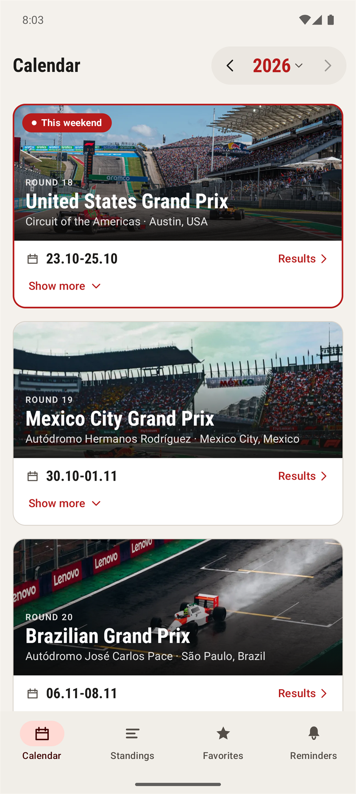
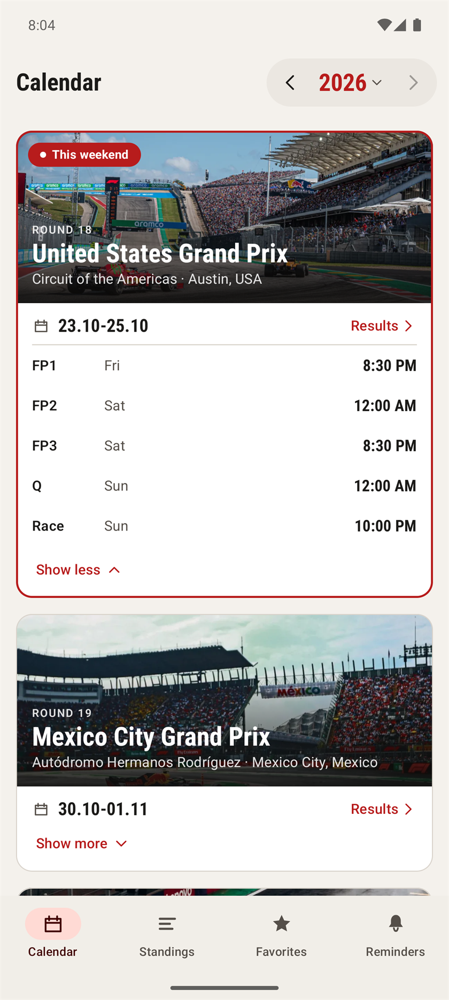
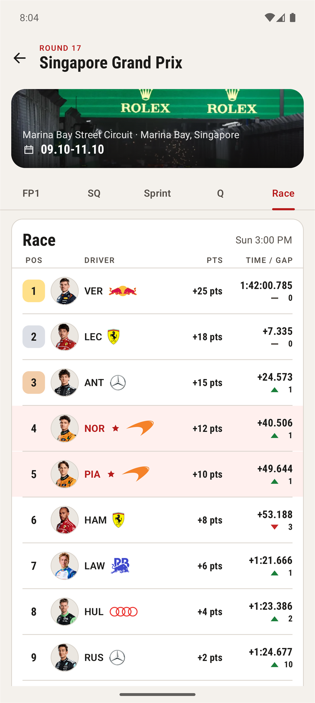
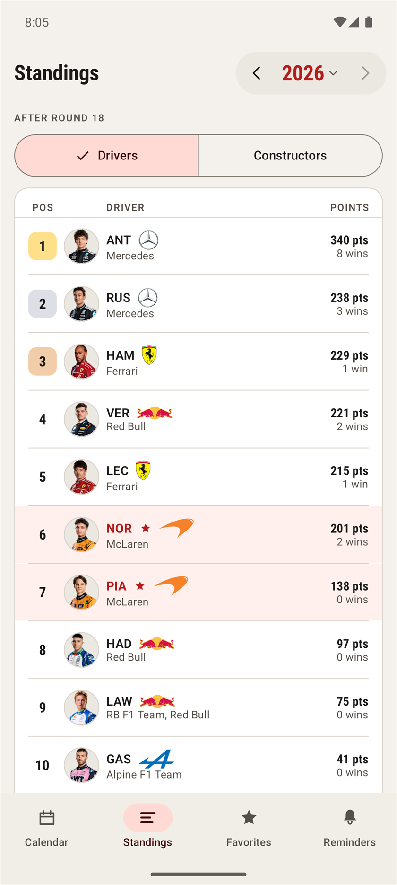
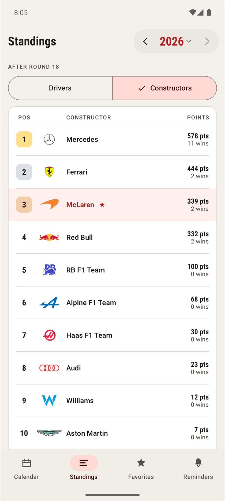
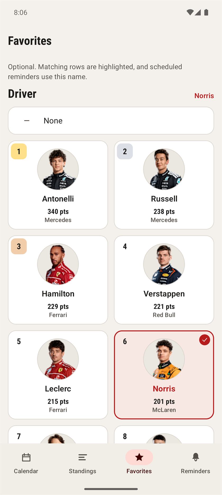
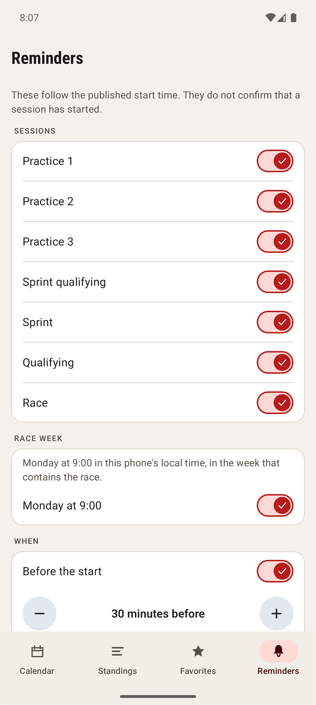
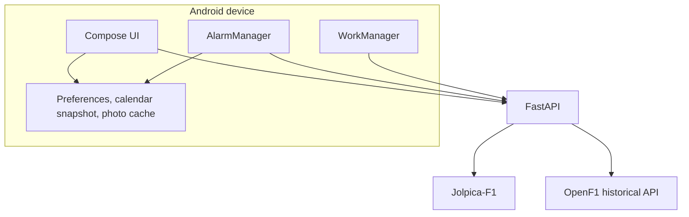

# FormulaTracker

A personal Android app for following a Formula 1 season: the race calendar, session times, results, championship standings, and reminders scheduled on the phone itself.

The app talks to a small FastAPI service. That service reads the free [Jolpica-F1](https://api.jolpi.ca/docs/) and [OpenF1](https://openf1.org/) APIs, then returns one normalized shape for the calendar, results, and standings. Jolpica is the primary source. OpenF1 fills in driver photographs and, from 2023 onward, session results that Jolpica has not published yet. There is no paid data tier and no live timing feed.

FormulaTracker is an independent project. It is not affiliated with Formula 1, the FIA, or the teams.

## Screenshots

Captured from the running app on an Android emulator, 25 October 2026, on the 2026 season. That emulator already had Norris saved as the favorite driver and a 30-minute reminder lead time. A new install uses 60 minutes.

<table>
  <tr>
    <td align="center" width="50%">
      <br>
      <sub>Season calendar</sub>
    </td>
    <td align="center" width="50%">
      <br>
      <sub>Weekend schedule</sub>
    </td>
  </tr>
  <tr>
    <td align="center">
      <br>
      <sub>Race results</sub>
    </td>
    <td align="center">
      <br>
      <sub>Driver standings</sub>
    </td>
  </tr>
  <tr>
    <td align="center">
      <br>
      <sub>Constructor standings</sub>
    </td>
    <td align="center">
      <br>
      <sub>Favorites</sub>
    </td>
  </tr>
  <tr>
    <td align="center" colspan="2">
      <br>
      <sub>Reminders</sub>
    </td>
  </tr>
</table>

## Features

**Calendar.** The season switcher runs from 1950 through the current year. Each Grand Prix shows the circuit, the weekend dates in the phone's timezone, and every scheduled session: practice, sprint qualifying, the sprint, qualifying, and the race, when that weekend has them. Times are stored in UTC and shown in the local timezone. A cancelled session is labelled as cancelled. If the saved current-season calendar is more than a day old, the screen says when it was last updated.

**Results.** Opening a weekend loads the sessions that were actually scheduled. Qualifying and sprint qualifying keep the segments a driver contested (`Q1`/`Q2`/`Q3` or `SQ1`/`SQ2`/`SQ3`). Race and sprint rows show position, status, laps, points, the provider's elapsed time or gap, and places gained or lost from the grid. An unclassified finish can appear as `NC`. Practice rows show the best lap and the lap count.

**Standings.** Driver and constructor tables come from the championship standings, including the round they were taken after. A driver who is in the table without a numeric position stays in the list. A driver who raced for more than one team keeps each team name.

**Favorites.** A favorite driver and team are optional. The choice is stored on the phone, highlighted in standings and results, and used in the wording of scheduled reminders. Empty is a valid choice.

**Photographs and logos.** Driver portraits are downloaded from OpenF1 URLs (2023 onward) and cached on the device. The last good URL list for a season is kept, so a later request can fail without wiping portraits that were already saved. A missing portrait falls back to the driver code. Team logos are bundled in the app. A team with no logo file uses a color circle from Jolpica's team color.

**Notifications, on the device.** Nothing is pushed from a server. The app schedules reminders with `AlarmManager`, restores them after reboot from the last saved calendar, and uses exact alarms when the system allows them. Otherwise the alarms are inexact, and the Reminders screen says they may arrive late.

- Each session type can be turned off on its own.
- A reminder before the start (60 minutes by default, adjustable from 1 to 1440 minutes in steps of 15) and a reminder at the published start time.
- A race-week reminder on Monday at 09:00 in the phone's local time, for the week that contains the race. A Monday morning that has already passed is skipped.
- The notification text says the session or race week is *scheduled*. It is not a claim that the session has started.
- A separate "session finished" notice, for 2023 onward. The phone asks the backend, which reads OpenF1 race control. One notice is posted per session after the last `SESSION FINISHED` status is available on the free tier. Checking starts from the expected end of the session and stops five hours later.
- Schedule changes. After the first successful save of the current season, a later refresh that finds a new start time or a cancellation for a future session posts one notification and replaces the affected alarms. The first save stays quiet. A failed request leaves the saved calendar alone.
- While the app is closed, WorkManager requests the current calendar about every six hours, and checks for finished sessions about every fifteen minutes, when a network is connected. Android may run either job later. The same backend address is used, so both checks need that backend to be reachable.
- The screen can post a sample reminder and a sample finished notice, and it links to the system screens for notification and exact-alarm permission.

Reminders always follow the phone's current season. Browsing an older year does not replace them.

## Limits

These are part of the design, not missing screens.

- There is no live timing, live positions, telemetry, or radio. A favorite driver does not generate alerts for overtakes, pit stops, or retirements.
- OpenF1's free API stops answering from about 30 minutes before a session until 30 minutes after it ends. During that window the backend cannot fetch new photographs or a finish status. Portraits already saved on the phone remain. A season opened for the first time inside that window has no portrait list yet.
- Jolpica remains the source of record when it has rows. OpenF1 supplies a result only when Jolpica has none, and only for sessions from 2023 that have already left the free-tier window. Points and the grid are filled from what OpenF1 exposes; the two feeds can still differ in small ways, such as a driver with no time in the final qualifying segment.
- Years before 2023 have no driver photographs and no session-finished notices. Older seasons also depend on what Jolpica still publishes. Practice, qualifying, and sprint results are not promised for every historical year.
- Schedule-change detection and the finished-session check are best effort. They run only after a successful request, and background work can be delayed by the system. They are not a live monitor.
- The backend keeps responses in memory for about 15 minutes and drops them on shutdown. There is no database.
- Names, classifications, and round labels are shown as the providers return them.

## Stack

| | |
| --- | --- |
| Android | Kotlin 2.2, Jetpack Compose, Material 3. minSdk 30, targetSdk 36, compileSdk 37. Android Gradle Plugin 9.4, Gradle 9.6. |
| Notifications | `AlarmManager`, `WorkManager` 2.12, `SharedPreferences`. No Firebase. |
| Backend | Python 3.12, FastAPI 0.143, Uvicorn 0.54, httpx 0.28. Pydantic models at the API boundary. |
| Runtime | Docker Compose. The API process has no database. |
| Data | [Jolpica-F1](https://api.jolpi.ca/docs/) for the calendar, results, standings, and team colors. [OpenF1](https://openf1.org/) free historical endpoints for photographs, a results fallback, and session-finished status. |
| Tests | pytest 9.1 on the backend. JUnit 4 on Android. |

## Architecture

The phone never calls Jolpica or OpenF1 itself. It calls FastAPI, which hides provider URLs, ids, and payload shapes behind a small set of season routes. The Android client is a single HTTP caller with a basic-auth header when the phone build has credentials configured.



Jolpica's schedule is normalized into weekends and sessions (`FP1`, `FP2`, `FP3`, `SQ`, `SR`, `Q`, `R`) with a UTC start, the circuit timezone, and a cancelled flag. Qualifying segments stay inside the result, not the calendar. Results, standings, team colors, and driver photographs go through the same kind of adapter. Successful responses are cached in the process for 15 minutes. An empty result is kept for a shorter time, and an OpenF1 fallback result is kept for at most five minutes, so a later Jolpica payload can replace it.

For day-to-day development the API is published on `127.0.0.1:8000`. The Android emulator reaches that port through `10.0.2.2`. A physical phone uses a separate build variant that calls `https://formulatracker.duckdns.org`. That hostname is served by Caddy in a separate infrastructure Compose project at `C:\Users\Victoria\server-infrastructure`. Caddy terminates TLS, requires HTTP basic auth, and proxies to this API on the Docker network `reverse-proxy`. DuckDNS for that name is updated by the same infrastructure project. Credentials stay in untracked files.

## Run it locally

### Prerequisites

- Docker, with Compose V2 (`docker compose`).
- Android Studio, or the Android SDK command-line tools plus a JDK that can run Gradle 9.6. JDK 21 was used for the build below.
- An emulator or a phone on Android 11 (API 30) or newer.

### Backend

```bash
git clone https://github.com/D14m0nDS/FormulaTracker.git
cd FormulaTracker
docker compose up -d --build backend
```

The API listens on [http://127.0.0.1:8000](http://127.0.0.1:8000). `GET /health` returns `{"status":"ok"}`. Interactive docs are at [http://127.0.0.1:8000/docs](http://127.0.0.1:8000/docs).

The Compose file defines only `backend`. That service joins the external Docker network `reverse-proxy` under the alias `formulatracker-api`, and publishes port 8000 on `127.0.0.1` only. On the server, the infrastructure project creates `reverse-proxy` before this stack starts. If the network is missing, create it once with `docker network create reverse-proxy`. The port is reachable from the emulator and from the host, and not from the public internet.

### Android emulator

The `emulator` build variant is the default. Its backend URL is `http://10.0.2.2:8000`, which is the emulator's alias for the host's loopback. Debug builds allow cleartext HTTP so that address works. No local credentials are required.

```bash
cd android
./gradlew :app:assembleEmulatorDebug
adb install -r app/build/outputs/apk/emulator/debug/app-emulator-debug.apk
adb shell am start -n com.formulatracker/.MainActivity
```

On Windows, use `gradlew.bat`. Start any emulator image first (`adb devices` should list it). Android Studio can open the `android/` directory and run the same `emulatorDebug` variant.

### Physical phone

The `phone` variant calls `https://formulatracker.duckdns.org` and sends HTTP basic auth. Before building it, add the matching username and password to `android/local.properties` (this file is gitignored):

```properties
backend.user=your-user
backend.password=your-password
```

```bash
cd android
./gradlew :app:assemblePhoneDebug
```

The APK is written under `app/build/outputs/apk/phone/debug/`. Install it on a device with USB debugging, or run the `phoneDebug` variant from Android Studio.

Production HTTPS is `https://formulatracker.duckdns.org`. Caddy in `C:\Users\Victoria\server-infrastructure` terminates TLS, requires HTTP basic auth, and proxies to `formulatracker-api:8000`. This repository does not start Caddy or DuckDNS, and its Compose file does not read an env file. The Caddy username, password hash, and DuckDNS token stay in that project's ignored `.env`. Keep `android/local.properties` off the repository. The loopback backend has no authentication; Caddy is what puts a password in front of the public API.

## API

All routes are `GET`. Years run from 1950 to 2100. The round is 1–30. Session type is one of `FP1`, `FP2`, `FP3`, `Q`, `SQ`, `R`, `SR`.

| Route | Purpose |
| --- | --- |
| `/health` | Liveness. |
| `/seasons/{year}/schedule` | Weekends, circuits, and sessions. |
| `/seasons/{year}/rounds/{round}/sessions/{session_type}/results` | Practice, qualifying, sprint, or race classification. |
| `/seasons/{year}/standings` | Driver and constructor championship tables. |
| `/seasons/{year}/drivers` | Driver codes and photograph URLs. Empty before 2023. |
| `/seasons/{year}/teams` | Team names and `#RRGGBB` colors. |
| `/seasons/{year}/session-finish` | Sessions whose free OpenF1 race-control feed reports a finish. |

A missing season, round, or session is `404`. An upstream failure is `502`. The full request and response models are in the generated docs at `/docs`.

## Tests

Backend, from `backend/` after `pip install -r requirements-dev.txt`:

```bash
python -m pytest
```

Android unit tests, from `android/`:

```bash
./gradlew :app:testEmulatorDebugUnitTest
```

The suites cover schedule and result normalization, the OpenF1 fallback, standings, favorites, reminder planning, schedule-change detection, and the session-finish alarm grid. Provider calls in the backend tests are local fixtures. On-device behavior of exact alarms, Doze, and a real OpenF1 finish still has to be checked on a phone.

## Roadmap

The current app is the Formula 1 season tracker described above. A few directions are intentionally left out:

- Formula 2, if it is ever added, would be a separate competition with its own calendar and results.
- Live timing, telemetry, and richer historical analysis would need another data source. [FastF1](https://docs.fastf1.dev/) is a candidate and is not integrated.
- Server-sent push was considered for the finished-session notice and was not adopted. Delivery stays on alarms scheduled by the phone.
- Accounts, multi-device sync, home-screen widgets, and a web client are outside this project.
